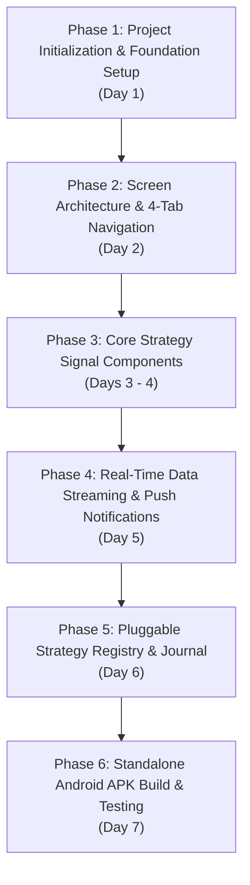

# Strategic Blueprint: Mobile Quantitative Signal & Strategy Radar Terminal
*(Pure Signal Screener, Real-Time Breakout Engine & Alert Station — No Broker Orders)*

**System Designation:** QuantPulse Mobile — Strategy Signal Radar & Intelligence Terminal  
**Target Workspace:** `C:\Project\QuantMobile`  
**Exchange & Timezone:** National Stock Exchange of India (NSE) • Indian Standard Time (IST, UTC+05:30)  
**Operating Paradigm:** **Zero Order Execution** — 100% focused on Real-Time Market Scanning, Quantitative Rule Evaluation, Signal Generation, Instant Push Alerts, and Hypothetical Performance Tracking.

---

## 1. Executive Summary & Paradigm Shift

By eliminating broker order routing, buy/sell dispatch, margin management, and panic kill-switch order square-offs, the mobile application transforms from a high-liability broker execution client into a **High-Performance Quantitative Intelligence & Real-Time Signal Radar**.

```
┌─────────────────────────────────────────────────────────────────────────────┐
│                          BEFORE: BROKER OMS CLIENT                          │
│  Live Market Feeds ──> Trigger ──> Broker API (Dhan) ──> Real Capital Risk  │
│  ❌ Broker 2FA logins   ❌ Margin rejections   ❌ Slippage / Order failures │
└─────────────────────────────────────────────────────────────────────────────┘
                                      │
                                      ▼
┌─────────────────────────────────────────────────────────────────────────────┐
│                   NEW PARADIGM: QUANTITATIVE SIGNAL RADAR                   │
│  Live Market Feeds ──> Strategy Rules ──> Deterministic Signals ──> Alerts  │
│  ✅ Instant Push Alerts   ✅ Zero Capital Risk   ✅ Virtual Performance Log │
│  ✅ Clean, Fast UI        ✅ SEBI / Broker Compliance Free                  │
└─────────────────────────────────────────────────────────────────────────────┘
```

### Why Removing Orders Makes the Mobile App Superior:
1. **Sub-Second Responsiveness:** No waiting for broker order API roundtrips, multi-leg order fills, or token refreshes.
2. **Zero Broker Auth Overhead:** No daily Dhan TOTP/OAuth re-logins before 09:15 AM.
3. **Pure Signal Fidelity:** Focuses 100% of the UI on quantitative clarity: volume ratio progress, exact trigger timestamps, dynamic ATM strikes, and candle breakout status.
4. **Frictionless Scalability:** Adding Strategy 4, 5, or 6 (e.g., 15-Min ORB, 3:10 PM BTST) requires zero order routing logic or margin calculations—only rule evaluation and alert dispatch.

---

## 2. Strategy Dissection: Signal-Only Mechanics

### 2.1 Strategy Comparison Matrix (Signals & Rules)

| Dimension | Strategy 1: 20D Volume Crossover | Strategy 2: NIFTY 09:20 Overnight | Strategy 3: NIFTY 180 Breakout | Future Strategies (e.g., ORB, 3:10 PM BTST) |
| :--- | :--- | :--- | :--- | :--- |
| **Strategy ID** | `20D_CROSSOVER` | `NIFTY_OVERNIGHT` | `NIFTY_BREAKOUT_180` | `ORB_15MIN`, `BTST_310PM` |
| **Asset Class** | NSE Equities & 55+ Stock Options (ATM CE) | NIFTY 50 Index Options (CE + PE) | NIFTY 50 Index Options (Directional CE or PE) | Index / Equities |
| **Scanning Window**| Continuous: 09:16:00 – 15:30:00 IST | Scheduled: Exactly 09:20:00 AM IST | High-Speed: 09:25:00 prep $\to$ 09:30:00–09:45:00 IST | Time-gated or bar-close |
| **Candidate Filter** | Cumulative traded volume $\ge$ 20D historical average | Closest to ₹62.50 premium in ₹50–₹75 range | Closest to ₹180 premium evaluated @ 09:25:00 AM | Breakout above high/low or close criteria |
| **Contract / Expiry** | Dynamic ATM strike based on underlying spot step | Nearest weekly expiry; **Skips today if today is expiry** | Current weekly expiry | Nearest weekly or monthly |
| **Signal Trigger** | Today Volume $\ge$ 20D Avg AND Spot LTP $\ge$ Open | Instant dual Signal @ 09:20:00 AM IST | 1st 1-min candle crossing above ₹180 after 09:30:00 | Candle close or indicator cross |
| **Stop Loss Level** | Equity: 1% • Option: 20% of Premium | Strict 25% Loss ($\text{Ref Price} \times 0.75$) | Fixed ₹160 Premium (-₹20 / -11.1%) | Configurable (e.g., ATR, 1-2%) |
| **Target Milestone** | Mathematical $\pi\%$ Targets ($+3.14\%$, etc.) | **STRICTLY ZERO TARGET** (Never exits on profit) | Fixed ₹220 Premium (+₹40 / +22.2%) | 1:2 R:R or trailing |
| **Signal Lifecycle** | Active $\to$ +1R $\to$ +2R $\to$ EOD Close (15:35) | 09:20 Entry $\to$ Intraday SL or Next-Day 09:25 AM | 09:30 Breakout $\to$ Target/SL or 09:45 AM Exit | Rule-based exit |
| **Max Signals / Day**| 1 per stock via monotonic latch | 1 Dual-Leg Strangle Signal | Exactly 1 Directional Breakout Signal | Configurable |
| **Overnight Status** | Intraday only (Closes @ 15:35 IST) | Marked `OVERNIGHT_HOLD` until 09:25 AM D+1 | Intraday only (Closes @ 09:45 AM IST) | Dependent on strategy |

---

### 2.2 Strategy Signal Lifecycles (No Orders)

```mermaid
flowchart TD
    subgraph S1 ["Strategy 1: 20D Volume Crossover"]
        S1_Scan["Scan 55+ Stocks (09:16 - 15:30)"]
        S1_Cross{"Today Vol >= 20D Avg & Price Bullish?"}
        S1_Latch["Latch Signal (Monotonic, 1/day)<br/>Recommend ATM CE Strike"]
        S1_Track["Virtual Trailing SL: 0R -> +1R (BE) -> +2R"]
        S1_Scan --> S1_Cross -->|Yes| S1_Latch --> S1_Track
    end

    subgraph S2 ["Strategy 2: NIFTY 09:20 Overnight (62.5)"]
        S2_Clock["Clock: 09:20:00 AM IST"]
        S2_Select["Resolve Expiry (Skip if Expiry Day)<br/>Pick CE & PE closest to ₹62.50 (₹50-₹75)"]
        S2_Lock["Lock Ref Prices & Set Strict 25% SL<br/>NO TARGET PRICE"]
        S2_Monitor{"LTP <= 25% SL?"}
        S2_NextDay["Hold Overnight -> Exit Signal @ 09:25 AM D+1"]
        S2_Clock --> S2_Select --> S2_Lock --> S2_Monitor
        S2_Monitor -->|Yes| S2_SL["Signal: SL Hit"]
        S2_Monitor -->|No| S2_NextDay
    end

    subgraph S3 ["Strategy 3: NIFTY 09:30 Breakout (180)"]
        S3_Prep["09:25:00 AM: Lock CE & PE closest to ₹180"]
        S3_Window["09:30:00 AM: Start 1-min Candle Evaluation"]
        S3_Break{"1st Candle > ₹180?"}
        S3_Trigger["Trigger Breakout Signal<br/>Permanently Disable Opposite Leg"]
        S3_Outcome["Track Target (₹220) / SL (₹160) / 09:45 Time Exit"]
        S3_Prep --> S3_Window --> S3_Break -->|Yes| S3_Trigger --> S3_Outcome
    end
```



---

## 3. Architecture Evaluation: Unified App vs. Separate Apps (Signal Radar Edition)

### Verdict
> [!IMPORTANT]
> **Build ONE Unified Multi-Strategy Radar App.**
> Even without order execution, a unified signal terminal is vastly superior to having 3 or 4 separate scanner apps on your phone.

### Why a Single Unified Radar App is Best:
1. **Single Morning Market Radar:** Between 09:15 and 09:45 AM, index options and volume crossovers happen in tight succession. A unified dashboard displays:
   - 09:20: Live ₹62.5 Strangle pair selected.
   - 09:25: ₹180 CE and PE candidates locked.
   - 09:30: Directional breakout trigger monitoring.
   - 09:35+: Volume crossover stocks popping up in real time.
2. **Unified Push Notification Center:** Receive all high-priority alerts (`CROSSOVER_ALERT`, `BREAKOUT_TRIGGERED`, `SL_WARNING`) in one clean notification stream.
3. **Pluggable for Future Strategies:** When you add the 15-Min ORB or 3:10 PM BTST strategy, it simply appears as a new **Signal Card** in the app.

---

## 4. Mobile Screen Architecture (Signal & Radar Focused)

With order slips and kill switches removed, the interface is lean, ultra-fast, and information-dense:

```
┌─────────────────────────────────────────────────────────────────────────────┐
│ ⚡ QUANTPULSE RADAR   |  NIFTY: 24,850 (+0.4%)  |  Signals Today: 4        │
├─────────────────────────────────────────────────────────────────────────────┤
│                                                                             │
│  [Tab 1: SIGNALS]      [Tab 2: RADAR]       [Tab 3: JOURNAL]   [Tab 4: OPS] │
│  Active Algos          20D Screener         Signal History     Settings     │
│                                                                             │
└─────────────────────────────────────────────────────────────────────────────┘
```

### Tab 1: `SIGNALS` (Live Systematic Algo Monitors)

Dynamic Strategy Cards displaying real-time signal conditions:

```
┌─────────────────────────────────────────────────────────────────────────────┐
│ 🟢 NIFTY 09:20 OVERNIGHT (₹62.5 STRANGLE)                    [SIGNAL ACTIVE] │
│ ─────────────────────────────────────────────────────────────────────────── │
│ Expiry: 22-OCT-2026 (Weekly - Today Expiry Skipped)                         │
│ • Leg 1 (CE): 24900 CE | Ref: ₹63.10 | LTP: ₹68.40 | SL: ₹47.30 (SAFE)      │
│ • Leg 2 (PE): 24700 PE | Ref: ₹61.90 | LTP: ₹45.20 | SL: ₹46.40 (SL HIT ❌) │
│ Invariant: 🛑 ZERO TARGET PRICE                                             │
│ Status: Leg 1 in OVERNIGHT_HOLD -> Exit Signal: Tomorrow 09:25:00 AM IST     │
└─────────────────────────────────────────────────────────────────────────────┘

┌─────────────────────────────────────────────────────────────────────────────┐
│ 🟡 NIFTY 09:30 ₹180 BREAKOUT                                [TRIGGERED 🚀] │
│ ─────────────────────────────────────────────────────────────────────────── │
│ Candidates Locked @ 09:25 AM:                                               │
│ • CE: 24850 CE ──> Broke ₹180 @ 09:32:00 (Trigger: ₹182.50) [ACTIVE]        │
│ • PE: 24800 PE ──> DISABLED (Opposite Leg Canceled)                         │
│ ─────────────────────────────────────────────────────────────────────────── │
│ Target: ₹220.00 (+₹37.50)  |  Stop Loss: ₹160.00 (-₹22.50)                 │
│ Time Exit: Forced Close in 08m 12s (@ 09:45:00 AM IST)                      │
└─────────────────────────────────────────────────────────────────────────────┘

┌─────────────────────────────────────────────────────────────────────────────┐
│ ➕ FUTURE STRATEGY CARD (e.g. 15-Min ORB / 3:10 PM BTST)                    │
│ [Dynamic plug-in slot for upcoming quantitative strategies]                 │
└─────────────────────────────────────────────────────────────────────────────┘
```

---

### Tab 2: `RADAR` (Strategy 1: 20-Day Cumulative Volume Screener)

* Full-screen virtualized list of 55+ F&O stocks.
* Real-time volume ratio progress bar: $\text{Volume Ratio} = \frac{\text{Today Traded Shares}}{\text{20D Average Shares}}$.
* Filter Chips: `All`, `🔥 Crossed (X)`, `⚡ Near Cross (>80%)`, `▲ Bullish`, `▼ Bearish`.
* Search bar for instant ticker lookups.
* **Tapping a stock opens the Tactical Strike Card (View Only):**
  * Spot LTP, Day Open, % Change, Day High/Low.
  * Today's Traded Shares vs. Exact 20D Average.
  * **Recommended ATM Option Strike:** Displays strike, estimated premium, 20% SL level, and $\pi\%$ target levels for quick reference if executing manually on your broker app.

---

### Tab 3: `JOURNAL` (Signal History & Theoretical Performance)

Since there are no live broker orders, this tab acts as the **Quantitative Audit Journal**:
* Chronological log of all signals generated today and historically.
* Theoretical outcome tracking:
  * Strategy 1: Did the stock reach +1R, +2R, or stop out?
  * Strategy 2: Net overnight gap points captured on next-day 09:25 AM open.
  * Strategy 3: Did the breakout hit ₹220, ₹160, or square off at 09:45 AM?
* Win Rate %, Profit Factor, and aggregate hypothetical points captured.
* 1-Click CSV export of signals.

---

### Tab 4: `SETTINGS & ALERTS`

* Push Notification Toggles:
  * `20D Volume Crossover Breakouts` (On/Off + custom sound/vibration).
  * `09:20 Strangle Leg Entry & 25% SL Alerts`.
  * `09:30 ₹180 Breakout Trigger & Time Exit Alerts`.
* Telegram Bot Alert Forwarding status.
* Live Marketfeed Status (connected to `QUANTPULSE` ingestion worker).

---

## 5. Multi-Tier Information Delivery: High-Level vs. Deep Details vs. Buy/Sell Notifications

The mobile application is designed with a **3-Tier Information Hierarchy** that answers all three needs: quick glances, deep quantitative inspection, and actionable lock-screen BUY/SELL alerts.

```
┌─────────────────────────────────────────────────────────────────────────────┐
│ TIER 1: INSTANT ACTIONABLE NOTIFICATIONS (LOCK-SCREEN BUY / SELL ALERTS)    │
│ Real-time push alerts with exact strikes, entry prices, SL, and targets     │
├─────────────────────────────────────────────────────────────────────────────┤
│ TIER 2: HIGH-LEVEL EXECUTIVE DASHBOARD (2-SECOND GLANCE)                    │
│ Clean status cards, market session state, active signal counters & points   │
├─────────────────────────────────────────────────────────────────────────────┤
│ TIER 3: DEEP QUANTITATIVE DETAILS (1-TAP DRILL-DOWN)                        │
│ 1-Min candle data, volume math, Greek estimates, and trailing SL ladders    │
└─────────────────────────────────────────────────────────────────────────────┘
```

---

### Tier 1: Actionable Lock-Screen Notifications (Explicit BUY / SELL / EXIT)

When a signal condition triggers on the server, your phone receives an immediate high-priority push alert with exact execution parameters. You can take immediate action on your broker terminal (e.g., Dhan, Zerodha, Groww) or verify the signal.

#### 1. Strategy 1 (20D Volume Crossover):
```
🔥 BUY SIGNAL: RELIANCE 20D Volume Breakout
• Trigger Time : 10:18:22 AM IST (Vol: 104% of 20D Avg)
• Spot LTP     : ₹2,945.50 (Bullish: Open ₹2,920, +1.2%)
• Rec. Strike  : 2940 CE @ ₹48.00
• Stop Loss    : ₹38.40 (-20%) | Target: ₹67.20 (+40%)
[Tap to Open Tactical Strike Dossier]
```

#### 2. Strategy 2 (NIFTY 09:20 Overnight Strangle):
* **At 09:20:00 AM IST (Entry Alert):**
  ```
  🟢 BUY SIGNAL: NIFTY 09:20 STRANGLE (Expiry: 22-OCT)
  • Leg 1: BUY 24900 CE @ ₹63.10 | Stop Loss: ₹47.30 (-25%)
  • Leg 2: BUY 24700 PE @ ₹61.90 | Stop Loss: ₹46.40 (-25%)
  ⚠️ INVARIANT: ZERO PROFIT TARGET. Hold overnight unless SL hits.
  ```
* **If 25% SL Hits Intraday:**
  ```
  🛑 SELL / SL ALERT: NIFTY 24700 PE
  Price dropped to ₹46.20 (-25% from Ref ₹61.90).
  EXIT PE LEG IMMEDIATELY at Market. CE leg remains open.
  ```
* **At 09:25:00 AM IST on Next Trading Day (Mandatory Exit):**
  ```
  🔔 EXIT SIGNAL: 09:25 AM Scheduled Overnight Close
  Market time reached. SELL remaining 24900 CE leg at current market price.
  ```

#### 3. Strategy 3 (NIFTY 09:30 ₹180 Breakout):
* **At 09:25:00 AM IST (Watchlist Lock Notification):**
  ```
  ⏱️ BREAKOUT WATCHLIST LOCKED @ 09:25 AM
  Watching 24850 CE (₹176.50) & 24800 PE (₹171.20).
  Evaluation starts at 09:30:00 AM IST.
  ```
* **When Candle Crosses ₹180 (BUY Alert):**
  ```
  🚀 BUY SIGNAL: NIFTY 24850 CE (₹180 Breakout)
  • Trigger Time: 09:32:00 AM (1-min candle crossed ₹180)
  • Entry Price : ₹182.50
  • Target Price: ₹220.00 (+₹37.50 / +20.5%)
  • Stop Loss   : ₹160.00 (-₹22.50 / -12.3%)
  ⛔ 24800 PE is CANCELED. Mandatory Time Exit @ 09:45:00 AM.
  ```
* **At 09:45:00 AM IST (If neither SL nor Target hit):**
  ```
  ⏱️ SELL / TIME EXIT: NIFTY 24850 CE
  09:45 AM hard time limit reached. Close position at current LTP.
  ```

---

### Tier 2: High-Level Dashboard (Glanceable Summary)

When you open the app, within 2 seconds you see:
* **Market Status Header:** Live IST clock (`09:31:45 IST`), market session (`ACTIVE_MARKET`), and total signals triggered today (`4 Signals`).
* **Summary Strategy Cards:**
  * **09:20 Strangle:** `1 Leg Active, 1 Stopped Out | Net: +12.5 pts`
  * **180 Breakout:** `24850 CE IN-TRADE | Target: ₹220 / SL: ₹160 | Time Left: 13m 15s`
  * **20D Radar:** `3 Stocks Crossed Today (RELIANCE, TATASTEEL, INFY)`
* **Daily Performance Pill:** Net theoretical points captured today (+45.2 pts) and Win/Loss count (2W / 1L).

---

### Tier 3: Deep Quantitative Details (1-Tap Drill Down)

Tapping on any card opens the complete quantitative breakdown:
* **For 20D Volume Crossover:**
  * Exact physical shares: Today's live traded shares (`4,821,390`) vs. Exact 20D average (`4,650,210`).
  * Opening Stabilization check: Confirms no volume phantom spike during 09:15–09:16.
  * Mathematical $\pi\%$ milestone ladder ($T_1 +3.14\%$, $T_2 +6.28\%$, $T_3 +9.42\%$, $T_4 +12.57\%$).
  * 4-State Trailing Stop-Loss gauge showing exact distance to Breakeven (+1R) and +1R Lock (+2R).
* **For 09:20 Overnight:**
  * Full expiry resolution trace: Shows why this expiry was selected (e.g. today is expiry $\to$ skipped to next weekly).
  * Independent distance calculation for CE and PE to ₹62.50.
  * Real-time distance of each leg to the 25% SL threshold.
* **For 09:30 Breakout:**
  * 1-Minute candlestick replay chart (Open, High, Low, Close of the trigger candle).
  * Time-elapsed vs. Time-remaining until the 09:45 AM hard cutoff.

---

## 6. Extensible Strategy Architecture (Plug-and-Play)

Since you have more strategies similar to this, the mobile app uses a **Modular Signal Plugin Interface**:

```typescript
// src/types/strategySignalPlugin.ts

export type StrategyCategory = 'INDEX_OPTIONS' | 'EQUITY_RADAR' | 'MOMENTUM_BREAKOUT' | 'EOD_BTST';

export interface StrategySignalState {
  strategyId: string;
  status: 'SCANNING' | 'PREPARING' | 'TRIGGERED' | 'SL_HIT' | 'TARGET_HIT' | 'TIME_EXIT' | 'COMPLETED';
  triggerTime?: string;
  triggerPrice?: number;
  currentPrice?: number;
  stopLoss?: number;
  target?: number;
  notes?: string;
}

export interface BaseSignalStrategyPlugin {
  id: string;                               // e.g. 'NIFTY_BREAKOUT_180', 'ORB_15MIN'
  title: string;
  category: StrategyCategory;
  operatingHours: { startIST: string; endIST: string };
  hasZeroTargetInvariant?: boolean;
  
  // Custom Card rendered on the Signals Tab
  renderCard: (props: { state: StrategySignalState }) => React.ReactElement;
  
  // Custom Detail/Modal view
  renderDetailModal?: (props: { state: StrategySignalState; onClose: () => void }) => React.ReactElement;
}
```

Adding a new strategy (e.g., 15-Minute ORB or 3:10 PM BTST) requires only:
1. Creating a plugin file defining the card UI and operating hours.
2. Registering it with `strategyRegistry.register(NewStrategyPlugin)`.
No order routing, no balance checks, no margin calculations!

---

## 7. Can You Implement This Directly in the Dhan App or Zerodha Kite App?

A natural question is: ***Can I just configure these strategies directly inside the official Dhan app or Zerodha Kite app instead of building a custom mobile app?***

### The Direct Answer: **NO, you cannot.**

Neither the Dhan mobile app nor the Zerodha Kite app supports the custom algorithmic logic, mathematical volume filtering, dynamic strike selection, or time-synchronized state machines required by these strategies.

---

### Comparison: Why Broker Apps Cannot Run These Strategies Natively

| Strategy Requirement | What Your Strategy Demands | What Dhan App / Zerodha Kite App Can Do | Can Broker App Run It? |
| :--- | :--- | :--- | :--- |
| **Strategy 1: 20D Volume Crossover** | Computes exact 20-day historical average traded shares from completed daily sessions. Latches monotonically when today's live volume crosses 100%. Filters 09:15–09:16 opening feed noise. | Basic watchlists, top gainers/volume shockers, simple % change alerts. No historical 20-day unrounded share average math. | ❌ **IMPOSSIBLE** |
| **Strategy 1: 4-State Trailing SL** | Automated state machine (+1R $\to$ breakeven; +2R $\to$ lock +1R; dynamic $\pi\%$ scaling). | Basic GTT (Good Till Triggered) orders for single entry and static SL/Target. Cannot trail dynamically based on multi-state milestone logic. | ❌ **IMPOSSIBLE** |
| **Strategy 2: 09:20 Overnight (62.5)** | Evaluates the full option chain at exactly 09:20:00 AM IST. Resolves expiry (skipping today if today is expiry). Finds CE & PE closest to ₹62.50 in ₹50–₹75 range. Holds overnight with **strictly zero profit target**; exits at 09:25:00 AM D+1. | Pre-set basket orders or alerts at static fixed strikes. Broker apps cannot dynamically inspect the live option chain at 09:20:00 to pick strikes by premium price. | ❌ **IMPOSSIBLE** |
| **Strategy 3: 09:30 ₹180 Breakout** | Scans contracts closest to ₹180 at 09:25:00. Monitors 1-min candles from 09:30 to 09:45. When the 1st leg crosses ₹180, **it permanently disables the opposite leg**. Forces exit at 09:45:00 AM. | Cannot perform conditional "if Leg A breaks out, cancel Leg B" logic (OCO across opposite option contracts). Cannot enforce automated candle-window gates (09:30–09:45) with hard time exits. | ❌ **IMPOSSIBLE** |
| **Future Strategies (e.g. ORB, 3:10 PM)** | Opening range breakout bar-close verification; EOD BTST time-gated signal generation. | Streak or Sensibull offer basic indicator alerts, but lack custom tick-level state machines, shared risk budgets, and multi-leg cross-cancellations. | ❌ **IMPOSSIBLE** |

---

### How Your Custom App Integrates With Dhan & Zerodha Kite

While you cannot *build the rules inside* their apps, your custom `QuantMobile` app works **in perfect harmony** with Dhan and Zerodha:

```
┌─────────────────────────────────────────────────────────────────────────────┐
│                 HOW QUANTMOBILE COMPLEMENTS YOUR BROKER                     │
├─────────────────────────────────────────────────────────────────────────────┤
│                                                                             │
│   [QUANTPULSE Backend Worker] (Computes 20D Vol, 09:20 & 180 Breakout)      │
│                │                                                            │
│                ▼                                                            │
│   [QuantMobile Companion App] (Actionable Push Notification buzzes phone)   │
│   "🚀 BUY NIFTY 24850 CE @ ₹182.50 | Target: ₹220 | SL: ₹160 | Exit: 09:45" │
│                │                                                            │
│                ▼ (1-Tap Deep Link / Quick Copy)                             │
│   [Zerodha Kite App / Dhan App Opens With Pre-Filled Order Slip]            │
│                │                                                            │
│                ▼                                                            │
│   [You swipe/tap once on your broker app to execute with 100% peace of mind]│
│                                                                             │
└─────────────────────────────────────────────────────────────────────────────┘
```

1. **1-Tap Deep-Linking to Broker Apps:**
   - Both Zerodha Kite (`kite://`) and Dhan (`dhan://`) support deep-linking intent schemes.
   - When a signal fires on `QuantMobile`, tapping the alert or the "Trade in Kite / Dhan" button can open your broker app directly with the pre-selected contract.
2. **Zero Broker API Token Hassles:**
   - Because you execute the final order inside your official broker app, you never have to worry about broken broker API tokens, TOTP expirations, or SEBI algo-approval regulations on mobile.

---

## 8. Phase-Wise Implementation Detail: Step-by-Step Build Plan

Here is the exact phase-by-phase roadmap to build the mobile application in `C:\Project\QuantMobile`:



---

### Phase 1: Project Initialization & Foundation Setup (Day 1)
* **Goal:** Scaffolding a rock-solid, production-grade React Native application in `C:\Project\QuantMobile`.
* **Deliverables:**
  1. Initialize Expo project with TypeScript template (`npx create-expo-app -t expo-template-blank-typescript .`).
  2. Install core packages:
     - Navigation: `@react-navigation/native`, `@react-navigation/bottom-tabs`, `react-native-screens`, `react-native-safe-area-context`.
     - State Management: `zustand` (ultra-lightweight, 0-boilerplate state store).
     - Native Capabilities: `expo-haptics`, `expo-notifications`, `expo-secure-store`, `expo-linear-gradient`.
  3. Define the **Obsidian Dark Terminal Theme** (`src/theme/colors.ts`) matching the desktop QuantPulse palette:
     - Background: `#0B0E14` | Card Surface: `#121824` | Border: `#1F293D`
     - Accents: Emerald (`#10B981`), Crimson (`#EF4444`), Amber (`#F59E0B`), Cyan (`#06B6D4`).
  4. Build the core REST API Service (`src/services/apiService.ts`) configured to query the `QUANTPULSE` backend.

---

### Phase 2: Screen Architecture & 4-Tab Navigation (Day 2)
* **Goal:** Establishing thumb-accessible, latency-free mobile navigation.
* **Deliverables:**
  1. Build the bottom tab navigator (`AppNavigator.tsx`) with 4 dedicated tabs:
     - `SIGNALS`: Real-time systematic algo command center.
     - `RADAR`: 20-day cumulative volume screener.
     - `JOURNAL`: Historical signal audit trail and theoretical P&L.
     - `SETTINGS`: Push alert configuration and broker deep-link preferences.
  2. Implement the **Top Market Header**:
     - Live ticking IST Clock with seconds (`09:19:58 IST`).
     - Market session pill (`PRE_MARKET`, `ACTIVE_SESSION`, `POST_MARKET`).
     - Real-time NIFTY 50 spot ticker and % change.

---

### Phase 3: Core Strategy Signal Components (Days 3 – 4)
* **Goal:** Building the visual intelligence cards for all 3 strategies.
* **Deliverables:**
  1. **Component 1: `Strategy_NiftyOvernightCard.tsx`**
     - Countdown badge to 09:20:00 AM IST.
     - Expiry resolution display (with warning badge if today's expiry was skipped).
     - Live CE & PE leg cards showing current LTP, entry reference price, and distance to 25% SL.
     - Prominent invariant banner: `🛑 STRICTLY ZERO PROFIT TARGET`.
     - Status transition: `SEARCHING` $\to$ `ACTIVE_HOLD` $\to$ `OVERNIGHT_HOLD` $\to$ `D+1 09:25 EXIT`.
  2. **Component 2: `Strategy_NiftyBreakout180Card.tsx`**
     - 09:25:00 AM Candidate Lock display (selected CE and PE contracts closest to ₹180).
     - 09:30:00–09:45:00 AM breakout radar: Live 1-min candle highs vs. ₹180 threshold.
     - First-breakout trigger state: Highlights the winning leg, visually strikes out and disables the opposite leg.
     - Live countdown timer to the mandatory 09:45:00 AM exit.
  3. **Component 3: `Radar_VolumeCrossoverList.tsx`**
     - Virtualized list rendering 55+ F&O stocks with zero lag.
     - Dynamic volume progress bar: $\text{Ratio} = \text{Today Shares} / \text{20D Avg Shares}$.
     - Quick filter chips: `All`, `🔥 Crossed (X)`, `⚡ Near Cross (>80%)`, `▲ Bullish`, `▼ Bearish`.
     - Tapping any stock opens the **Tactical Strike Card**: Displays spot price, exact volume stats, and recommended ATM Call/Put strikes with calculated 20% SL and $\pi\%$ targets.

---

### Phase 4: Real-Time Data Streaming & Push Notifications (Day 5)
* **Goal:** Sub-second alerts on your lock-screen and real-time UI data synchronization.
* **Deliverables:**
  1. Integrate **Supabase Realtime WebSocket** listener:
     - Listens to `crossover_events`, `strategy_nifty_overnight`, and `strategy_nifty_breakout_180` tables.
     - Instantly updates the mobile UI when server workers log a trigger.
  2. Configure **Expo Notifications & Firebase Cloud Messaging (FCM)**:
     - Background message handler to display lock-screen alerts when the app is closed.
     - Distinct sound and vibration profiles (e.g. sharp double vibration for Breakout BUY signals; persistent alert for SL hit).
  3. Implement **Broker Deep-Linking**:
     - Quick action button on every signal card: `Open in Zerodha Kite` / `Open in Dhan`.
     - Uses URL intents (`kite://` / `dhan://`) to navigate straight to the relevant contract.

---

### Phase 5: Pluggable Strategy Registry & Journal (Day 6)
* **Goal:** Ensuring the app is ready for your future quantitative strategies.
* **Deliverables:**
  1. Implement `BaseSignalStrategyPlugin` and `strategyRegistry`:
     - Allows registering future strategies (e.g., 15-Minute ORB, 3:10 PM BTST) by dropping in a new plugin file.
  2. Build the **Signal Audit Journal (`JournalScreen.tsx`)**:
     - Chronological timeline of all signals fired today and across past sessions.
     - Hypothetical performance metrics: Total points captured, Win Rate %, Profit Factor, Largest Win, Largest Loss.
     - Filter by strategy (`ALL`, `20D_CROSSOVER`, `NIFTY_OVERNIGHT`, `NIFTY_BREAKOUT_180`).

---

### Phase 6: Standalone Android APK Build & Testing (Day 7)
* **Goal:** Producing an installable `.apk` file directly on your physical Android phone.
* **Deliverables:**
  1. Configure `eas.json` build profile:
     ```json
     {
       "build": {
         "preview": {
           "android": {
             "buildType": "apk"
           }
         }
       }
     }
     ```
  2. Trigger cloud build via EAS CLI:
     ```bash
     eas build -p android --profile preview
     ```
  3. Download the `.apk` via the generated QR code/link and install directly on your phone.
  4. Conduct live market testing during the active 09:15–15:30 IST window.

---

## 9. Summary & Recommendation

1. **Why Not Dhan or Kite Directly?**
   Broker apps cannot run programmatic 20-day historical volume calculations, dynamic strike selection at 09:20, or cross-leg breakout cancellations at 09:30.
2. **The Ideal Hybrid Model:**
   - **`QUANTPULSE` Backend:** Evaluates mathematical rules and detects signals.
   - **`QuantMobile` Custom App:** Alerts you with exact strikes, targets, and stop-losses.
   - **Dhan / Kite App:** Used simply to punch the trade with 1 tap.
3. **Execution Ready:**
   All specifications, architectural contracts, and the 6-phase plan are ready to be built in `C:\Project\QuantMobile`.

